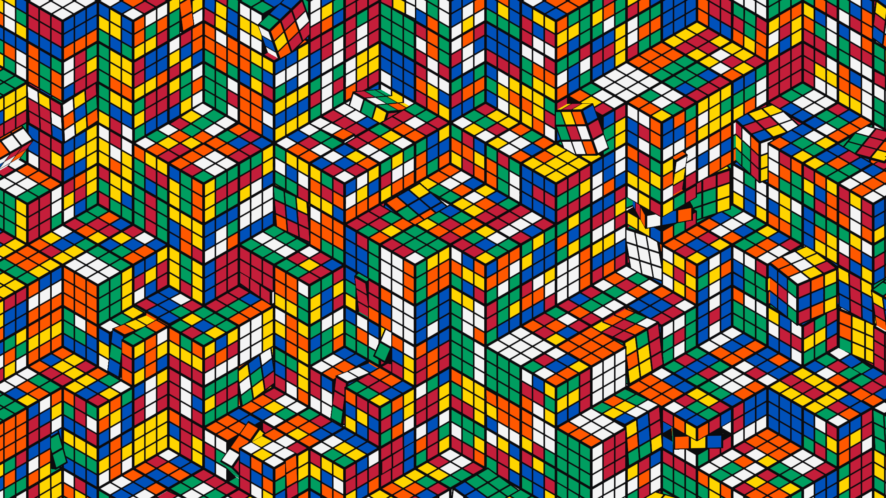

# Omacube

An animated desktop background for Omarchy: an endless isometric stack of 3x3 puzzle cubes, drawn flat in sticker colours with black lines, like a vector illustration that never stops moving.



- **An endless stack.** The view looks straight down a cube's diagonal at an infinite pile of cubes with random gaps, so the top layers form interlocking hexagonal stars and staircases. The field drifts slowly past.
- **Real cubes, real turns.** Every cube is a legal puzzle state: a solved cube put through its own scramble. Each one runs on its own clock. It makes three moves, each a single layer turn or a whole-cube tumble, rests, then undoes them in reverse. Sticker colours travel with the turning layers.
- **Workspaces turn the stack.** Every workspace switch rolls the whole stack 120 degrees with a flick-and-settle overshoot. That's the isometric view's own symmetry, so the pattern clicks back into line like a cube turn.

Everything is drawn by one GPU fragment shader. The plugin reads no files, runs no processes and makes no network connections. See [DISCLOSURE.md](DISCLOSURE.md).

## Install

```bash
omarchy plugin add https://github.com/Tiedeyez/omacube.git --enable
```

Omacube is a `service` plugin. When it's enabled it draws on every screen, on the layer just above your normal wallpaper and below your windows. Clicks pass straight through to the desktop.

## Remove

```bash
omarchy plugin disable tiedeyez.omacube
omarchy plugin remove tiedeyez.omacube
```

Your normal wallpaper shows again as soon as the plugin is disabled. Nothing else needs cleaning up, because the plugin writes no files.

## Optional companion theme

`theme/omacube/` is a matching Omarchy theme. It has a black-plastic palette with the six sticker colours, a sticker-gradient window border, and "layer click" window and workspace animations: a fast flick, a small overshoot and a settle. It also turns on Omarchy's workspace slide animation, so windows slide sideways while the stack turns.

The plugin doesn't install it for you. To use it:

```bash
cp -r ~/.config/omarchy/plugins/tiedeyez.omacube/theme/omacube ~/.config/omarchy/themes/
omarchy theme set omacube
```

Omarchy only loads a theme's `hyprland.lua` (the animations and border) from a theme in your own themes folder, which is why the theme is copied rather than installed from git.

## Performance

- The shader renders at 75% of screen resolution and redraws 24 times a second. Both settings are at the top of `Service.qml`.
- It stops redrawing while a fullscreen window covers the screen.
- Any animated wallpaper makes the compositor repaint the whole screen on every frame, including blur behind translucent windows. On an RTX 4070 SUPER at 3440x1440, GPU power went from about 6.5 W to about 16.5 W with Omacube enabled. Most of that is the repainting; lowering the shader's resolution made no measurable difference. Expect a bigger relative cost on integrated graphics. On a weak GPU, lower `renderScale` and `fps` in `Service.qml`.
- The animation loops seamlessly: the cubes every 70 minutes, the drifting field every 12.8 hours. Nothing jumps when either loop wraps.

## How it's checked

[MATH.md](MATH.md) explains the maths: the isometric camera, the distance function that keeps the ray march from stepping through a turning cube, real cube states, timing, seamless loops, hashing and antialiasing. Two sets of checks back it up:

- `python3 tools/check-math.py` re-derives every claim in plain Python, using brute force where the shader takes shortcuts. It needs only the standard library.
- `dev/selfcheck.sh` builds debug versions of the shader and renders them on your GPU. Each check paints failing pixels magenta, then counts them. It needs a running Wayland session with Quickshell.

## Development

- `shaders/omacube.frag` is the shader source. `shaders/omacube.frag.qsb` is the compiled form Qt loads. Rebuild it with `tools/build-shader.sh` (needs `qt6-shadertools`).
- `dev/preview.sh [outdir] [frames] [fps] [t0] [width] [height] [qsb]` renders PNG frames without installing the plugin.
- After editing `Service.qml`, run `omarchy restart shell`.

## Credits

Built by Tiedeyez. MIT licence. "Omacube" is an independent fan project and is not affiliated with any puzzle-cube trademark holder.
